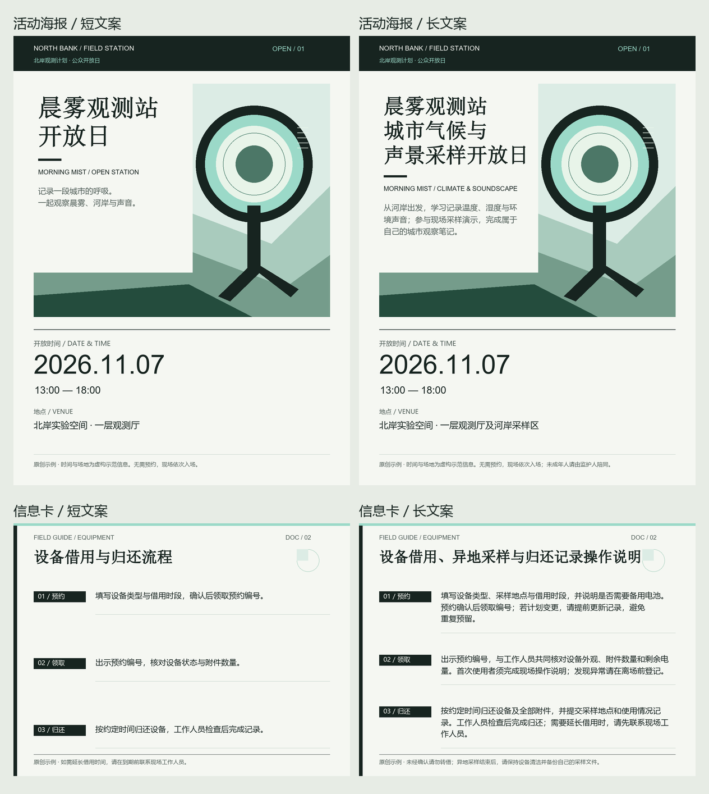

# 终末地构成排版设计 · Endfield Layout Design

用于创作具有《明日方舟：终末地》官方宣传排版气质的原创海报、信息卡片与页面的 Agent Skill。通过真实图例研究构图、阅读顺序和信息层级，再服务于用户的文案与素材。

**当前版本：v1.0.0 · 首次公开发布：2026-11-04。**



图中为本项目自制几何图形与虚构文案，不含官方角色或 Logo。

## 包含内容

- 聚焦的 [SKILL.md](skills/endfield-layout-design/SKILL.md)：制作流程、布局选择和交付自检。
- 构图家族、排版规则及逐图分析，覆盖形象海报、活动横幅、资料卡和页面。
- 40 张研究参考图、31 条来源记录，保留原帖、图片地址、尺寸、日期和 SHA-256；研究采集记录日期为 2026-10-12。
- 原创海报和资料卡的可编辑 SVG、PNG、长文案示例与验证记录。
- 本地示例渲染和来源完整性审计脚本。

适用于明确要求终末地宣传排版气质的任务；普通工业风或科幻 HUD 请求不自动触发。本包数字和字体建议是研究归纳与原创制作默认值，不是官方 VI 规范。

## 安装与使用

在 Codex 中可直接提出：

```text
$skill-installer 从 https://github.com/HonmaMisuzu0306/endfield-layout-design/tree/v1.0.0/skills/endfield-layout-design 安装这个技能。
```

也可在 [v1.0.0 Release](https://github.com/HonmaMisuzu0306/endfield-layout-design/releases/tag/v1.0.0) 下载 GitHub 自动生成的 **Source code (zip)**，解压后将其中 `skills/endfield-layout-design` 的完整文件夹放入项目的 `.agents/skills/`，使入口位于 `.agents/skills/endfield-layout-design/SKILL.md`。全局个人技能可放入 `~/.agents/skills/`。请保留整个文件夹中的相对路径；目标已有同名技能时先备份。安装与发现方式参考 [OpenAI 官方技能文档](https://learn.chatgpt.com/docs/build-skills)。

调用示例：

```text
使用 $endfield-layout-design，为我的展览制作 1200×1600 竖版海报。
保留以下完整文案与日期，使用我提供的品牌色和图片。
交付可编辑 SVG 和 PNG，并检查长文案、字形及边界溢出。
```

按需查看 [构图说明](skills/endfield-layout-design/references/compositions.md)、[排版规则](skills/endfield-layout-design/references/layout-rules.md) 和 [官方参考来源](skills/endfield-layout-design/references/sources.md)。下载后可在浏览器打开 `skills/endfield-layout-design/references/gallery.html` 查看离线参考画廊；GitHub 文件页不直接运行 HTML。

## 示例脚本

技能说明、SVG 和 PNG 可直接阅读。运行随包的两类示例渲染脚本需要 Python 3、Pillow，以及 Windows 的微软雅黑 `msyh.ttc`、宋体 `simsun.ttc`、Arial `arial.ttf`（脚本读取 `C:/Windows/Fonts`）。本包不分发字体；未完成 macOS/Linux 渲染验收。

在仓库根目录执行：

```powershell
python -m pip install -r requirements.txt
python skills/endfield-layout-design/scripts/render_examples.py --out ./rendered-examples
python skills/endfield-layout-design/scripts/audit_assets.py
```

`--spec` 可指定 JSON 文案，结构见 [example-spec.json](skills/endfield-layout-design/assets/examples/example-spec.json)。渲染输出包括 PNG、可编辑 SVG 和几何检查报告。辅助脚本只实现两类示例构图；其他构图需按内容制作。`audit_assets.py` 会重建来源索引与画廊，并校验原图哈希、尺寸、解码、去重及本地 Markdown 链接。

## 验证范围

- **2026-10-12 历史设计验收**：四张海报/资料卡及长文案预览、一次独立信息卡使用测试；记录见 [历史验证报告](skills/endfield-layout-design/references/validation.md)。
- **2026-11-04 本次发布检查**：技能格式、UTF-8/UI 元数据、40 张参考图的哈希与解码、本地链接、四张示例重新渲染与几何约束、Release 压缩包完整性。未将本次包装检查描述为新的全面设计验收。
- 页面模式已有构图与响应式规则；本次未制作网站。SVG 在其他编辑器的字体匹配和像素一致性尚未验证。

## 来源与权利

这是非官方研究项目。官方图片、角色、Logo、宣传文案及合作品牌权利属于各自权利人；仓库公开不意味着取得这些素材的商业使用或再许可授权。本次发布未为原创内容新增开源许可证。详见 [来源与权利说明](skills/endfield-layout-design/references/distribution.md)。
